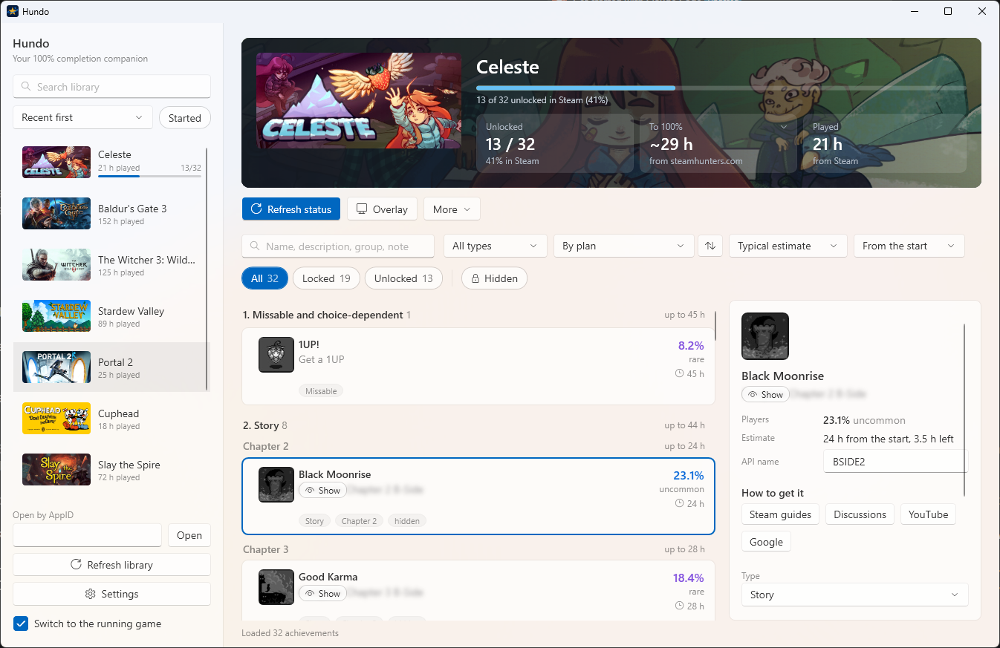
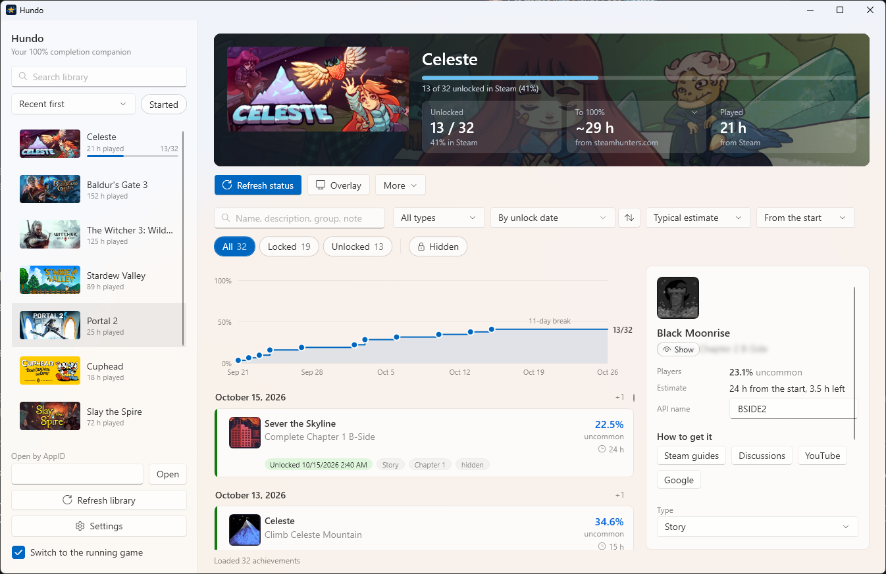
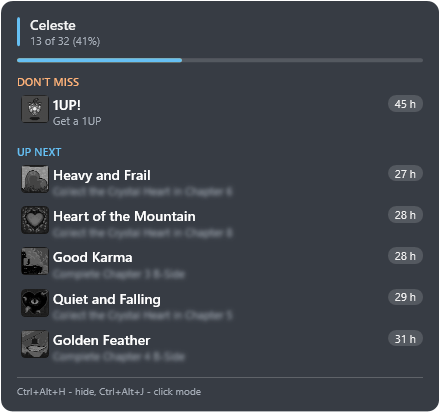

  

<h1 align="center">Hundo</h1>

  Your 100% completion companion for Steam games on Windows. 
  <a href="../../releases/latest"><b>Download</b></a>

  

## Run

1. Download `Hundo-<version>-win-x64-setup.exe` from [Releases](../../releases/latest) and run it, or unpack the portable zip anywhere. Needs Windows 10 or 11 (x64) and the Steam client.
   If Windows SmartScreen stops it, click More info > Run anyway.
2. In Settings, paste a [Steam Web API key](https://steamcommunity.com/dev/apikey) (domain: `localhost`) to load your library and progress.

## Hotkeys

| Keys | Action |
| --- | --- |
| `Ctrl+Shift+A` | Show or hide the overlay |
| `Ctrl+Shift+S` | Overlay click mode: drag it to another place |
